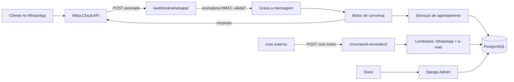

# WhatsApp Bot

Bot de atendimento e agendamento para pequenos negócios (barbearia, clínica, loja): responde perguntas frequentes pelo WhatsApp, agenda horários **sem conflito** e envia confirmações e lembretes por WhatsApp e e-mail. O dono gerencia tudo pelo Django Admin.


> **Status:** MVP completo, em produção no Render (plano gratuito). A integração com a Meta Cloud API foi testada de ponta a ponta com o número de teste da Meta: o webhook real recebe a mensagem, valida a assinatura, localiza o negócio, gera a resposta do bot e a Meta aceita o envio. A **entrega no WhatsApp do celular é recusada pela Meta** com o erro 130497 (conta comercial restrita de enviar mensagens para este país). Veja [Limitações conhecidas](#limitações-conhecidas).

## Funcionalidades

- **Atendimento automático (WhatsApp)**: horário de funcionamento, preços e endereço, com o texto das respostas editável pelo dono.
- **Agendamento pelo chat**: o cliente escolhe serviço, dia e horário; o sistema confirma e **nunca marca dois clientes no mesmo horário**.
- **Confirmação e lembretes**: e-mail de confirmação na hora e lembrete antes do horário, por e-mail e WhatsApp.
- **Painel do dono (Django Admin)**: agendamentos, conversas, respostas do bot, serviços e horários. Cada dono vê **apenas o próprio negócio**.
- **Segurança e LGPD desde o projeto**: assinatura do webhook validada, limite de requisições, nenhum dado pessoal nos logs.

## Arquitetura



Cada app Django tem uma responsabilidade (`businesses`, `customers`, `conversations`, `bot`, `scheduling`, `notifications`, `whatsapp`). As views só recebem a requisição; a regra de negócio fica em funções de serviço, fáceis de testar.

```
whatsapp-bot/
├── apps/
│   ├── businesses/      # negócio, serviços, horários de funcionamento
│   ├── customers/       # clientes (telefone, e-mail, consentimento)
│   ├── conversations/   # conversa, mensagens, estado do fluxo
│   ├── bot/             # respostas editáveis e motor de conversa
│   ├── scheduling/      # agendamentos e regras de conflito
│   ├── notifications/   # e-mails e lembretes
│   └── whatsapp/        # webhook, assinatura, client da Meta, status de entrega
├── config/              # settings separados (base, dev, prod) e urls
├── docs/                # guia de deploy e GIF de demonstração
├── scripts/             # simulador do webhook e chat de demonstração
├── tests/               # testes automatizados (pytest)
├── requirements/        # base.txt (produção) e dev.txt
├── build.sh             # build do deploy
└── LICENSE
```

## Stack

Python 3.11 · Django 5.2 · Django REST Framework · PostgreSQL (Neon) · django-anymail (Brevo) · gunicorn · WhiteNoise · pytest · Render

## Como rodar localmente

Pré-requisitos: Python 3.11+ e um banco PostgreSQL (o [Neon](https://neon.tech) tem plano gratuito). O SQLite **não** serve: a garantia de horários sem conflito usa um recurso exclusivo do PostgreSQL.

```bash
git clone https://github.com/LuisFelipe100508/whatsapp-bot.git
cd whatsapp-bot
python -m venv .venv
# Windows: .venv\Scripts\activate    |    Linux/macOS: source .venv/bin/activate
pip install -r requirements/dev.txt

cp .env.example .env        # Windows: copy .env.example .env
# edite o .env: gere DJANGO_SECRET_KEY e defina DATABASE_URL

python manage.py migrate
python manage.py create_owner_group
python manage.py createsuperuser
python manage.py runserver
```

Gere chaves com `python -c "import secrets; print(secrets.token_urlsafe(64))"`.

No admin (`http://127.0.0.1:8000/admin/`), cadastre um **negócio** com `ID do número no WhatsApp = TESTE-123`, um **serviço** e os **horários** (uma linha por dia da semana). Depois:

```bash
python manage.py seed_bot_replies     # cria as respostas padrão, editáveis no admin
python scripts/chat_demo.py           # conversa com o bot no terminal, sem a Meta
```

Para simular a Meta enviando um webhook assinado: `python scripts/simulate_webhook.py "Oi"`.

Em desenvolvimento os e-mails aparecem no terminal. Todas as variáveis estão documentadas no [`.env.example`](.env.example).

## Testes

```bash
python -m pytest -v
```

92 testes cobrem: conflito de horários (inclusive no banco), segurança do webhook (assinatura, token, idempotência, rate limit, logs sem dados pessoais), registro de falhas de entrega sem dados pessoais, fluxo completo de agendamento, isolamento do admin entre donos, lembretes idempotentes e o endpoint do cron.

## Segurança

- Segredos só em variáveis de ambiente; `.env` fora do Git, com `.env.example`.
- Webhook: assinatura `X-Hub-Signature-256` (HMAC-SHA256 sobre o corpo bruto, comparação em tempo constante) e token de verificação. **Sem segredo configurado, tudo é recusado.**
- `DEBUG=False` e `ALLOWED_HOSTS` restrito em produção; HTTPS forçado, HSTS e cookies seguros.
- Limite de requisições no webhook (60/min) e no endpoint do cron (30/min); corpo máximo de 256 KB.
- Endpoint do cron protegido por token (mínimo de 32 caracteres) e painel admin em caminho não padrão.
- Somente a API oficial da Meta (nenhuma biblioteca não oficial de WhatsApp, que arrisca banimento).
- Nenhum telefone, nome ou texto de mensagem nos logs (LGPD).

## Decisões técnicas

- **Conflito de horários garantido pelo banco.** Validar só em Python não basta: duas mensagens simultâneas passam pela checagem ao mesmo tempo. Uma *exclusion constraint* do PostgreSQL (`btree_gist`) impede, mesmo com concorrência, dois agendamentos confirmados sobrepostos. A checagem em Python dá a resposta amigável; o banco é a barreira final. Um teste desliga a checagem de propósito e prova isso.
- **Assinatura validada sobre o corpo bruto.** O HMAC é calculado sobre os bytes exatos recebidos, antes de qualquer parse de JSON.
- **O webhook responde 200 para eventos ignorados** (negócio desconhecido, mídia). Responder erro faria a Meta reenviar o mesmo evento por dias. Só assinatura inválida (403), JSON inválido (400) e excesso de requisições (429) recebem erro.
- **Falhas de entrega registradas sem dados pessoais.** Os eventos de status da Meta (`failed`) são logados só com código e título do erro. O telefone, os IDs de contato e o ID da mensagem ficam de fora: o `wamid` embute o telefone codificado em base64.
- **Idempotência.** O ID único da mensagem na Meta evita processar entregas repetidas; nos lembretes, uma constraint por agendamento e canal, mais uma reivindicação por *compare-and-swap* no contador de tentativas, impede envio duplicado mesmo com dois crons simultâneos. A prioridade é nunca enviar duas vezes.
- **Motor de conversa como máquina de estados**, com trava de linha por conversa (`select_for_update`) e contexto só com IDs e datas (nunca dado pessoal). Contexto inconsistente reinicia a conversa em vez de prender o cliente.
- **Rede fora da transação.** As respostas só são enviadas depois do commit, para nenhuma trava de banco ficar presa esperando a Meta.
- **Textos editáveis sem brecha.** Os placeholders (`{horarios}`, `{precos}`...) são preenchidos em uma única passada com regex; um serviço chamado `{endereco}` não é reinterpretado.
- **Lembretes com cron externo, não agendador interno.** O Render gratuito dorme e, com vários processos, um agendador interno duplicaria envios. Um cron gratuito chama um endpoint protegido, e o job é idempotente. O APScheduler fica disponível para uso local (`run_scheduler`).
- **WhatsApp fora da janela de 24 h exige template aprovado.** O lembrete usa template quando configurado, ou texto livre se o cliente escreveu nas últimas 24 h. O e-mail é o canal garantido.
- **E-mail por API HTTPS, não SMTP, em produção.** O plano gratuito do Render bloqueia as portas SMTP, então produção usa a Brevo via `django-anymail`. O SMTP/Gmail continua disponível em desenvolvimento ou em hospedagem sem esse bloqueio, trocando só uma variável.
- **Privacidade (LGPD).** Erros registram só o nome da exceção (a mensagem pode conter dados pessoais); o telefone aparece mascarado no admin; o consentimento de e-mail é registrado com data; cada dono só enxerga o próprio negócio; o dono não apaga agendamentos, só cancela.
- **Um processo gunicorn com várias threads.** O limite de requisições usa o cache em memória do processo; com vários processos o limite real se multiplicaria.
- **Defaults seguros.** Configurações separadas por ambiente, `DEBUG=False` por padrão e variáveis obrigatórias sem valor padrão: o app recusa iniciar mal configurado.

## Limitações conhecidas

- **Entrega no WhatsApp recusada pela Meta na conta de teste.** O envio é aceito pela API, mas a entrega ao celular falha com o erro 130497 (conta comercial restrita de enviar mensagens para este país). Os lembretes por WhatsApp teriam a mesma falha; o e-mail é o canal garantido. As falhas são registradas (só código e título do erro).
- **Entrega "no máximo uma vez" para o bot.** A mensagem é gravada antes de o bot responder. Se o bot falhar depois disso, a reentrega da Meta é ignorada como duplicada e o cliente fica sem resposta. A evolução seria marcar a mensagem como processada só depois de o bot concluir.
- O envio de mensagens é **síncrono** dentro da requisição. A evolução natural é uma fila de tarefas (Celery ou RQ).
- O bot **não cancela nem remarca**: orienta o cliente a falar com o estabelecimento.
- Uma agenda por negócio e fuso horário único (`America/Sao_Paulo`). Vários profissionais exigiriam um model `Professional`.
- **E-mails inexistentes** (bounce) não são tratados: seria preciso receber os eventos da Brevo por webhook.
- **Sem domínio próprio**, os e-mails saem por um remetente da Brevo e podem cair no spam.
- O serviço gratuito do Render pode levar cerca de 1 minuto para acordar; o cron periódico mitiga isso.
- Apenas mensagens de texto; mídia é ignorada.

## Deploy

Render (plano gratuito) + Neon (PostgreSQL) + Brevo (e-mail) + cron-job.org (lembretes). Passo a passo em [`docs/DEPLOY.md`](docs/DEPLOY.md).

## Licença

MIT. Veja [`LICENSE`](LICENSE).

> Projeto de portfólio. Os cuidados de LGPD aqui descritos são boas práticas técnicas, não assessoria jurídica.